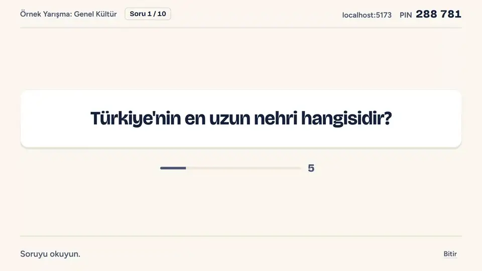
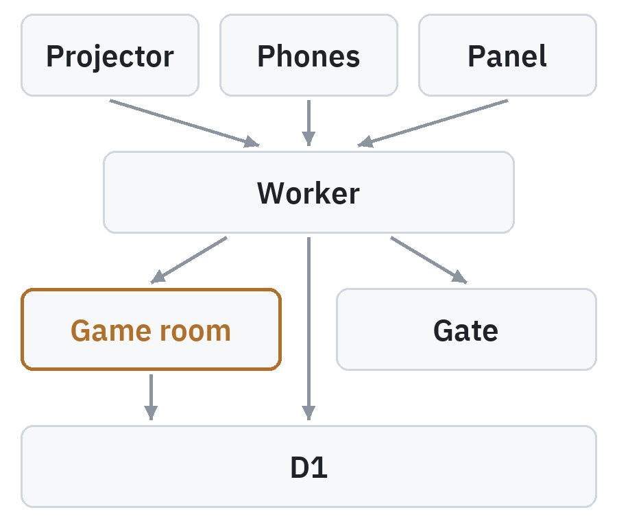
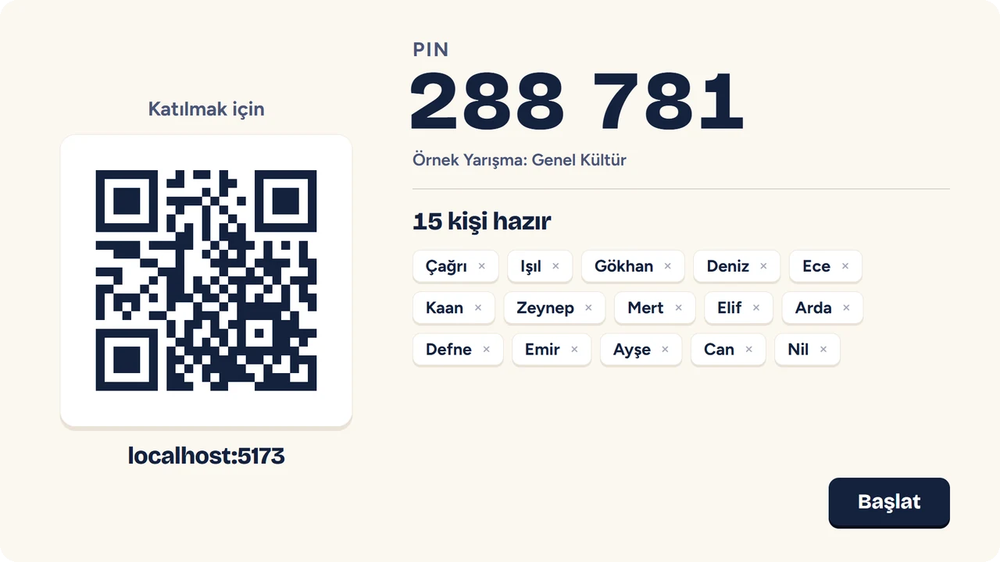
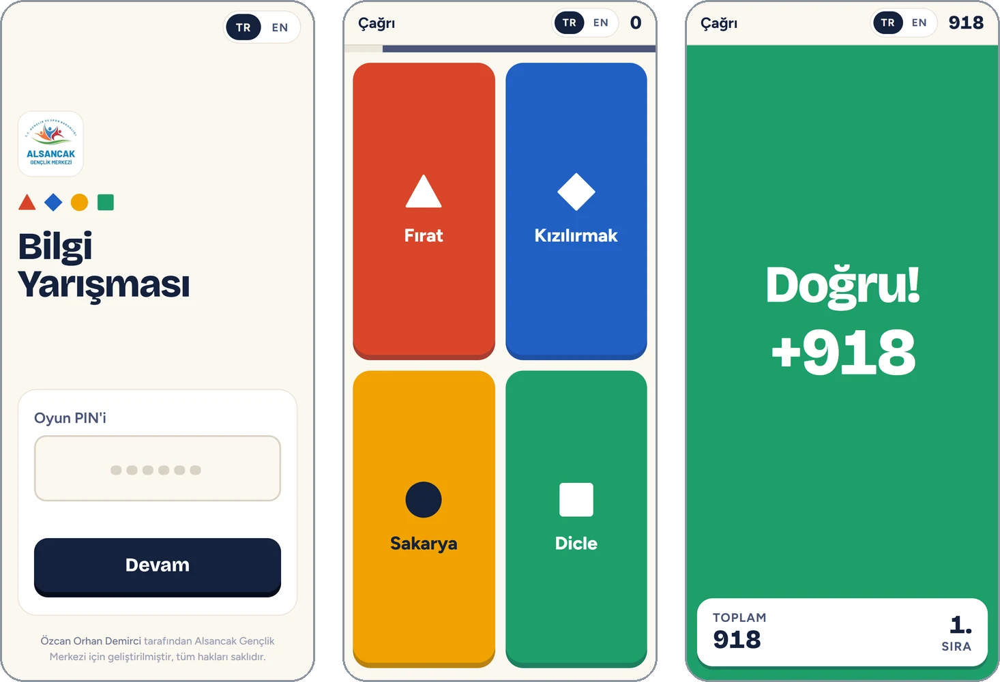
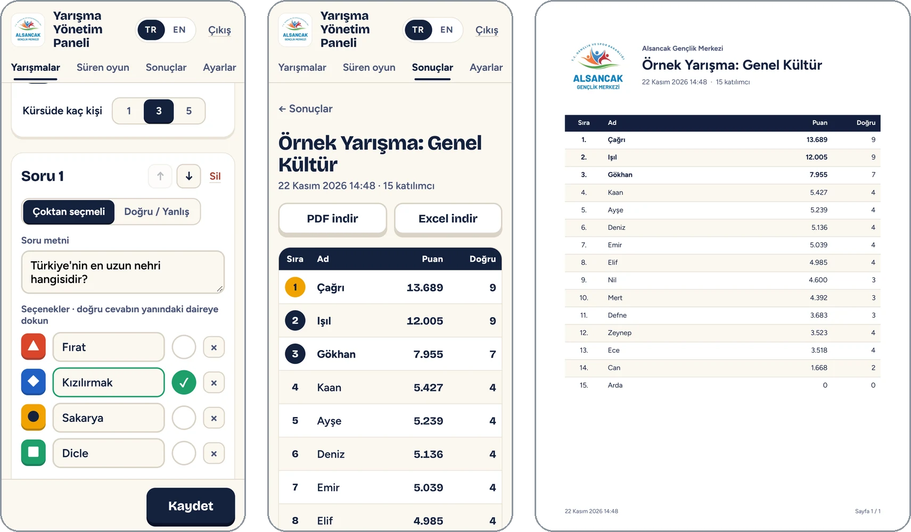

<!-- Showcase of a private project by Özcan Orhan Demirci. Media and how to rebuild it: see UPDATING.md. -->

# Bilgi Yarışması

A live quiz web app I built for Alsancak Gençlik Merkezi, a youth centre in İzmir. The quiz runs on the projector; players answer on their own phones, with no app and no account.

One question and the podium on the projector, recorded from a local run with bot players.

The centre runs quizzes often and used Kahoot for them. This app replaces it, on Cloudflare's free tier, and it has one test to pass: no player should come away thinking "this is worse than Kahoot". Free is a constraint to engineer around, never a reason to give students less.

## <picture><source media="(prefers-color-scheme: dark)" srcset="media/headings/n01-dark.png"></picture> What it does

- The quiz goes up on the projector with a QR code and a 6-digit PIN. Players scan it and join from the phone's browser with a nickname. No app, no account, no personal data.
- Timed questions, multiple choice (2 to 4 options) or true/false, scored on correctness and speed. Per quiz, staff can turn on double points for chosen questions, a streak bonus and triple points on the last question.
- After each question the projector reveals the answer and a moving leaderboard; each phone shows the player's own score and place. The podium shows the top 1, 3 or 5.
- A phone that drops comes back into the same game with its score, and a late phone is never turned away. If the projector's computer closes, the game goes on and picks up when the screen is opened again.
- A staff panel to prepare and store quizzes, run them and read results, behind one shared staff password with an owner override. Results stay available and export as an official PDF or Excel sheet with the centre's logo.
- Turkish and English throughout; the interface follows the device's language and can be switched.

The design sits between plain government white and Kahoot's childishness: fun but not silly, mature but not bureaucratic. Motion carries the fun more than colour does: warm white, dark navy type, and colour spent on the answers, the scores and the celebration. Every screen is drawn for a cheap 1080p projector in a lit room.

## <picture><source media="(prefers-color-scheme: dark)" srcset="media/headings/n02-dark.png"></picture> How it is built

<picture><source media="(prefers-color-scheme: dark)" srcset="media/diagram-dark.png"></picture>

- **Projector, phones, panel:** one static React site on Cloudflare Pages.
- **Worker:** the API, and the way in for each WebSocket.
- **Game room:** one Durable Object per live game, the single source of truth. It keeps the clock, the scoring and the leaderboard, and the right answer never reaches a phone before the reveal. Its WebSockets use hibernation, so a quiet room costs nothing while it waits.
- **Gate:** one Durable Object that maps PINs to game rooms and guards staff sign-in.
- **D1:** quizzes and results. They live in SQL rather than in a Durable Object's storage, so they can be read from outside for backups and keep seven days of point-in-time history. A finished game keeps its own copy of the quiz, so editing a quiz later never changes an old result.

## <picture><source media="(prefers-color-scheme: dark)" srcset="media/headings/n03-dark.png"></picture> What was measured

**Fair timing on mobile data.** Players mostly join on mobile data, where latency jitters. A question is read first with its options hidden; then a small start message opens it, and the clock is the server's. Each phone measures its own round trip with the runtime's automatic ping reply, which neither wakes the room nor counts as a request, and sends its latest samples with the answer. The server credits the median plus a small margin, capped, so no phone can look faster than the network allows. In a local comparison with 400 bots, the share of correct answers that kept the player's own time rose from 69–71% to 90%, and the points lost per correct answer fell from 7.3–7.8 to 5.3. In a 400-bot lobby on Cloudflare, about 48,000 of these pings cost zero Durable Object requests.

**400 players in one game.** A bot harness plays the way Turkish 4G and 5G behave: jitter, stalls of a second or two, a phone switching networks, a locked screen. 400 bots played one game on Cloudflare from the lobby to the podium, and all 400 results were recorded.

**A CPU problem only the cloud showed.** The nickname filter uses terlik.js, a Turkish profanity library of 147 regular expressions. On a fresh Cloudflare isolate it compiled them lazily, each join cost 4 to 7 seconds of CPU, and the lobby froze; local runs, a 400-bot local load included, never showed it. The fix is an exact pre-filter that runs only the patterns that could match. Over about 230,000 test strings it makes zero decisions that differ from the full filter, and the room's CPU time now peaks at 55 ms.

**Long answers shrink instead of hiding.** When an option is too long, every option of that question shrinks to one common size, so no answer is easier to read than another.

**Result sheets made in code.** The PDF is built with pdfmake in one click, not through a browser's print dialog, so every browser and phone gets the same document; fonts are self-hosted and checked for every Turkish glyph. Excel comes from ExcelJS. Both load only when staff export and never reach a player's phone. Names in other alphabets show correctly on the projector, the phones, the panel and both sheets (tested in Chrome with Arabic, Chinese, Cyrillic and Persian names).

**A light first load.** On a throttled phone profile (400 kbit/s, 400 ms round trip, CPU slowed six times), first paint went from 4.2 s to 1.2 s and the page from 289 KB to 215 KB. Preloading the fonts was tried and dropped: they competed with the code and held the name field back by 1.5 to 4 seconds.

**Tests.** 113 unit and 59 integration tests; each integration file starts its own local Workers runtime. Mutation testing with Stryker on three core server modules: 96.7% for scoring, 94% for the three together. Each surviving mutant was read: equivalent, or unable to change a score or who gets in.

## <picture><source media="(prefers-color-scheme: dark)" srcset="media/headings/n04-dark.png"></picture> Screens

The lobby on the projector: QR code, PIN, and the names as players join.

On the phone: joining, the answer keys, a right answer.

The staff panel on a phone, editing a question and reading a game's results, and the PDF result sheet.

## <picture><source media="(prefers-color-scheme: dark)" srcset="media/headings/n05-dark.png"></picture> About

I decided what it does and how it is built, and checked it on real phones and a real projector; Claude Code wrote the code.

TypeScript · React · Motion · Cloudflare Workers · Durable Objects · D1 · Pages · pdfmake · ExcelJS · Vitest · Stryker

The source code is private. This repository documents the product: the page, its pictures and the scripts that make them.

[mail@ozcanorhandemirci.com](mailto:mail@ozcanorhandemirci.com) · [LinkedIn](https://www.linkedin.com/in/ozcan-orhan-demirci) · [More of my work](https://github.com/OzcanOrhanDemirci)

 

<b>Türkçe</b>

 

Alsancak Gençlik Merkezi için geliştirdiğim canlı bilgi yarışması. Yarışma projeksiyonda akar, oyuncular kendi telefonlarından cevap verir; uygulama kurmak da hesap açmak da gerekmez.

En üstteki döngü: projeksiyonda bir soru ve kürsü, botlarla oynanan yerel bir oyundan kaydedildi.

Merkez sık sık yarışma düzenliyor ve bunun için Kahoot kullanıyordu. Bu uygulama onun yerini Cloudflare'in ücretsiz katmanında alıyor ve geçmesi gereken tek bir sınav var: hiçbir oyuncu "Kahoot varken bu ne böyle" dememeli. Ücretsiz olmak mühendislikle karşılanan bir kısıt; öğrenciye daha azını vermenin gerekçesi değil.

## <picture><source media="(prefers-color-scheme: dark)" srcset="media/headings/n01-dark.png"></picture> Ne yapar

- Yarışma projeksiyonda bir QR kod ve 6 haneli bir PIN'le açılır. Oyuncular kodu okutup telefon tarayıcısından bir takma adla katılır. Uygulama yok, hesap yok, kişisel veri yok.
- Süreli sorular: 2 ila 4 şıklı çoktan seçmeli ya da doğru/yanlış; puan doğruluktan ve hızdan gelir. Personel her yarışma için seçtiği sorularda çift puanı, seri bonusunu ve son soruda üç kat puanı açıp kapatabilir.
- Her sorudan sonra projeksiyon doğru cevabı ve kıpırdayan sıralamayı gösterir; her telefon oyuncunun kendi puanını ve sırasını. Kürsüde ilk 1, 3 ya da 5 kişi çıkar.
- Bağlantısı kopan telefon aynı oyuna puanıyla geri döner, geç gelen telefon asla geri çevrilmez. Projeksiyondaki bilgisayar kapanırsa oyun sürer, ekran yeniden açılınca kaldığı yerden devam eder.
- Yarışmaları hazırlamak, saklamak, başlatmak ve sonuçları okumak için bir personel paneli: personelin bildiği tek ortak şifre, yanında sahibin şifresi. Sonuçlar hep erişilebilir kalır ve merkezin logosuyla resmî bir PDF ya da Excel olarak iner.
- Baştan sona Türkçe ve İngilizce; arayüz cihazın dilini izler, istenirse değiştirilir.

Tasarım, devlet beyazının sadeliğiyle Kahoot'un çocuksuluğu arasında duruyor: eğlenceli ama cıvık değil, olgun ama kasıntı değil. Eğlenceyi renkten çok hareket taşıyor: sıcak beyaz zemin, koyu lacivert yazı; renk cevaplara, puanlara ve kutlamaya harcanıyor. Her ekran ışıklı bir odadaki ucuz bir 1080p projeksiyon için çizildi.

## <picture><source media="(prefers-color-scheme: dark)" srcset="media/headings/n02-dark.png"></picture> Nasıl kuruldu

<picture><source media="(prefers-color-scheme: dark)" srcset="media/diagram-dark.png"></picture>

- **Projeksiyon, telefonlar, panel:** Cloudflare Pages'te tek bir statik React sitesi.
- **Worker:** API ve her WebSocket'in giriş kapısı.
- **Oyun odası (Game room):** her canlı oyun için bir Durable Object, oyunun tek doğru kaynağı. Saat, puan ve sıralama onda durur; doğru cevap açıklanmadan hiçbir telefona gitmez. WebSocket'leri hibernasyonlu, yani sessizce bekleyen bir oda hiçbir şeye mal olmaz.
- **Kapı (Gate):** PIN'leri oyun odalarına bağlayan ve personel girişini koruyan tek bir Durable Object.
- **D1:** yarışmalar ve sonuçlar. Bir Durable Object'in deposunda değil SQL'de dururlar; böylece yedek için dışarıdan okunabilirler ve yedi günlük geçmişleri saklanır. Biten her oyun yarışmanın kendi kopyasını tutar, yarışma sonradan düzenlense de eski sonuç değişmez.

## <picture><source media="(prefers-color-scheme: dark)" srcset="media/headings/n03-dark.png"></picture> Ölçülenler

**Mobil veride adil süre.** Oyuncuların çoğu mobil veriyle bağlanıyor, orada gecikme dalgalanır. Soru önce şıkları kapalı okunur, sonra küçük bir başla mesajı onu açar; saat sunucunundur. Her telefon kendi gidiş-dönüş süresini çalışma zamanının otomatik ping cevabıyla ölçer; bu cevap odayı uyandırmaz ve istek sayılmaz. Telefon son ölçümlerini cevabıyla yollar; sunucu süreyi, ölçümlerin medyanına küçük bir pay ekleyerek ve bir tavanla sınırlayarak telefon lehine düzeltir; hiçbir telefon ağın izin verdiğinden hızlı görünemez. 400 botla yerel kıyasta oyuncunun kendi süresini koruyan doğru cevapların payı %69-71'den %90'a çıktı, doğru cevap başına kaybedilen puan 7,3-7,8'den 5,3'e indi. Cloudflare'deki 400 botluk bir lobide bu ping'lerden yaklaşık 48.000'i gitti, hiçbiri Durable Object isteği sayılmadı.

**Tek oyunda 400 oyuncu.** Bot düzeneği Türkiye'deki 4G ve 5G gibi davranır: dalgalanan gecikme, bir iki saniyelik takılmalar, ağ değiştiren telefon, kilitlenen ekran. 400 bot Cloudflare'de lobiden kürsüye tek bir oyun oynadı ve 400 sonucun hepsi kaydedildi.

**Yalnız bulutta görünen bir işlemci sorunu.** Takma ad süzgeci 147 düzenli ifadeli Türkçe bir küfür kütüphanesi olan terlik.js'i kullanıyor. Taze bir Cloudflare izolatında desenleri tembel derliyordu, her katılım 4-7 saniye işlemci yiyordu ve lobi donuyordu; yerel koşular, 400 botluk yerel yük dahil, bunu hiç göstermedi. Çözüm yalnız eşleşebilecek desenleri koşturan kesin bir ön eleme. Yaklaşık 230.000 deneme dizesinde tam süzgeçten farklı tek bir karar vermiyor; odanın işlemci süresi artık en çok 55 ms.

**Uzun şık saklanmaz, küçülür.** Bir şık uzun gelirse o sorunun bütün şıkları ortak bir boyuta küçülür; hiçbir cevap ötekinden kolay okunmaz.

**Kodla üretilen sonuç belgeleri.** PDF tarayıcının yazdırma penceresinden değil, tek tıkla pdfmake'le üretilir; her tarayıcı ve telefon aynı belgeyi alır. Fontlar kendi barındırılır ve her Türkçe harf için denetlendi. Excel'i ExcelJS üretir. İkisi de yalnız personel dışa aktarırken yüklenir, oyuncunun telefonuna hiç gitmez. Başka alfabelerdeki adlar projeksiyonda, telefonlarda, panelde ve iki belgede de doğru görünür (Chrome'da Arapça, Çince, Kiril ve Farsça adlarla denendi).

**Hafif bir ilk açılış.** Kısılmış bir telefon profilinde (400 kbit/s, 400 ms gidiş-dönüş, işlemci altı kat yavaş) ilk boyama 4,2 sn'den 1,2 sn'ye, sayfa 289 KB'tan 215 KB'a indi. Fontları önceden yüklemek denendi ve bırakıldı: kodla yarışıp ad alanını 1,5-4 saniye geciktirdiler.

**Testler.** 113 birim ve 59 entegrasyon testi; her entegrasyon dosyası kendi yerel Workers çalışma zamanını açar. Sunucunun üç çekirdek modülünde Stryker'la mutasyon testi: puan modülünde %96,7, üçünün toplamında %94. Hayatta kalan her mutant tek tek okundu: ya eşdeğer ya da bir puanı veya kimin girdiğini değiştiremiyor.

## <picture><source media="(prefers-color-scheme: dark)" srcset="media/headings/n04-dark.png"></picture> Ekranlar

Projeksiyonda lobi: QR kod, PIN ve katıldıkça beliren adlar.

Telefonda: katılış, cevap tuşları, doğru bir cevap.

Telefonda personel paneli, soru düzenlerken ve bir oyunun sonuçlarında; yanında PDF sonuç belgesi.

## <picture><source media="(prefers-color-scheme: dark)" srcset="media/headings/n05-dark.png"></picture> Hakkında

Ne yapacağına ve nasıl kurulacağına ben karar verdim, gerçek telefonlarda ve gerçek bir projeksiyonda ben denetledim; kodu Claude Code yazdı.

TypeScript · React · Motion · Cloudflare Workers · Durable Objects · D1 · Pages · pdfmake · ExcelJS · Vitest · Stryker

Kaynak kodu paylaşılmıyor; bu depo ürünü belgeler: sayfa, görselleri ve onları üreten betikler.

[mail@ozcanorhandemirci.com](mailto:mail@ozcanorhandemirci.com) · [LinkedIn](https://www.linkedin.com/in/ozcan-orhan-demirci) · [Öteki işlerim](https://github.com/OzcanOrhanDemirci)

 

The Alsancak Gençlik Merkezi logo seen in the app's screens belongs to Alsancak Gençlik Merkezi; it is shown because the app was built for the centre. Kahoot! is a trademark of Kahoot! ASA. Other names and logos belong to their owners. © 2026 Özcan Orhan Demirci. All rights reserved.
